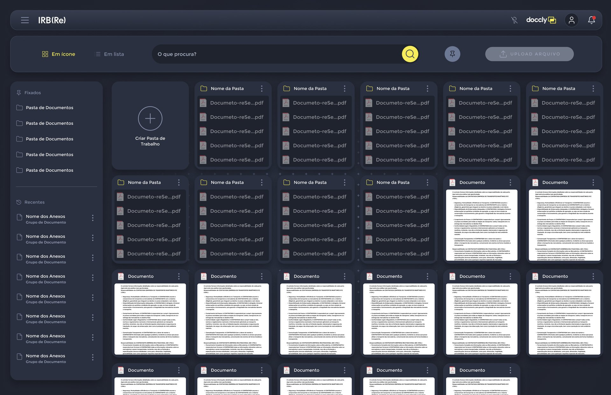
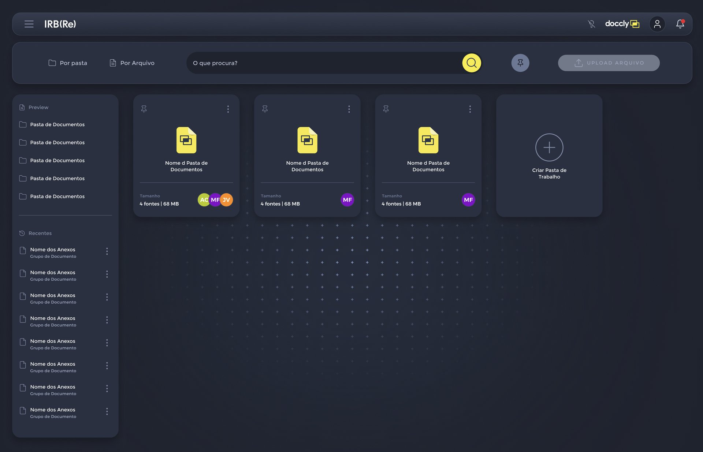
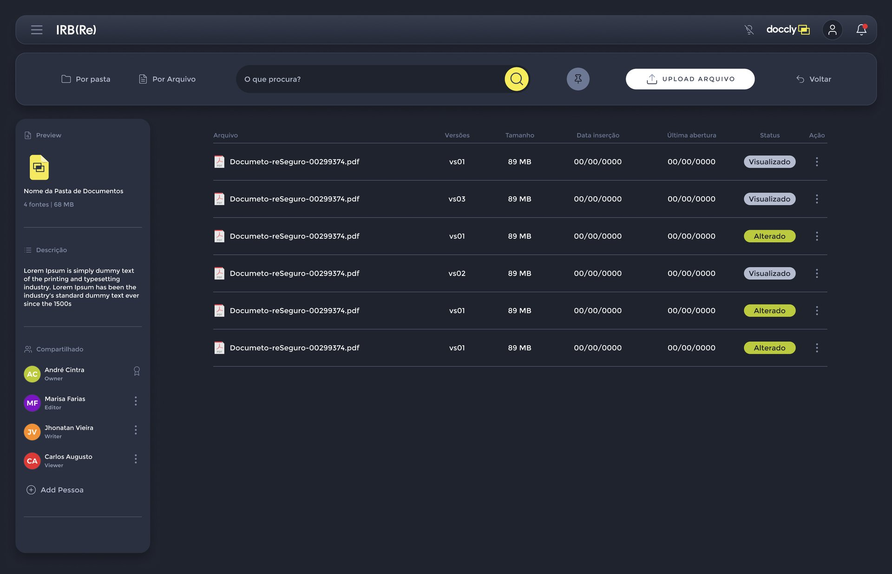
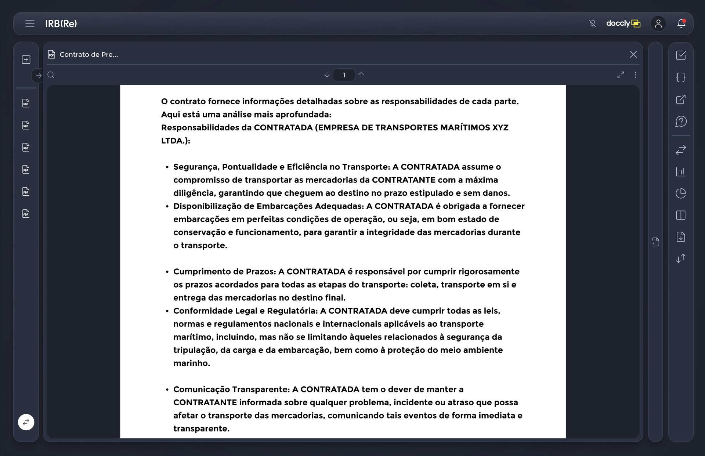
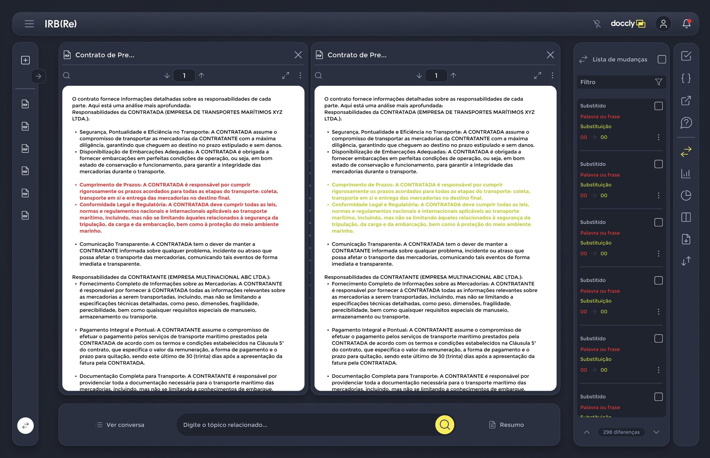
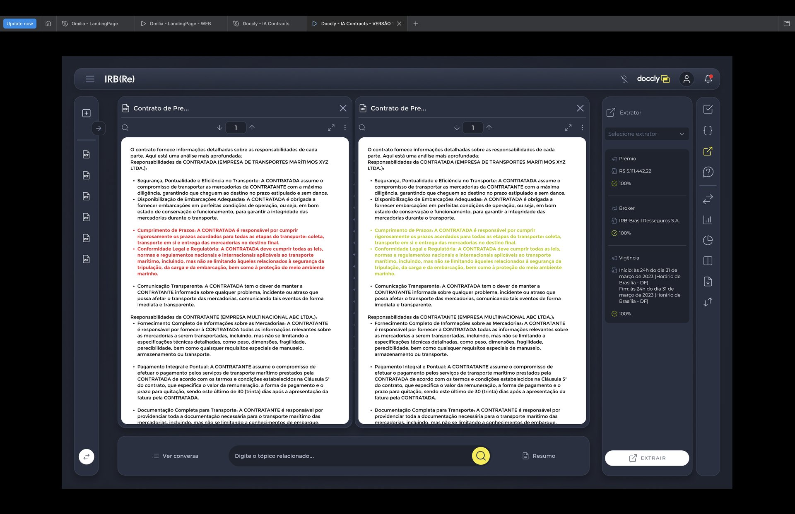
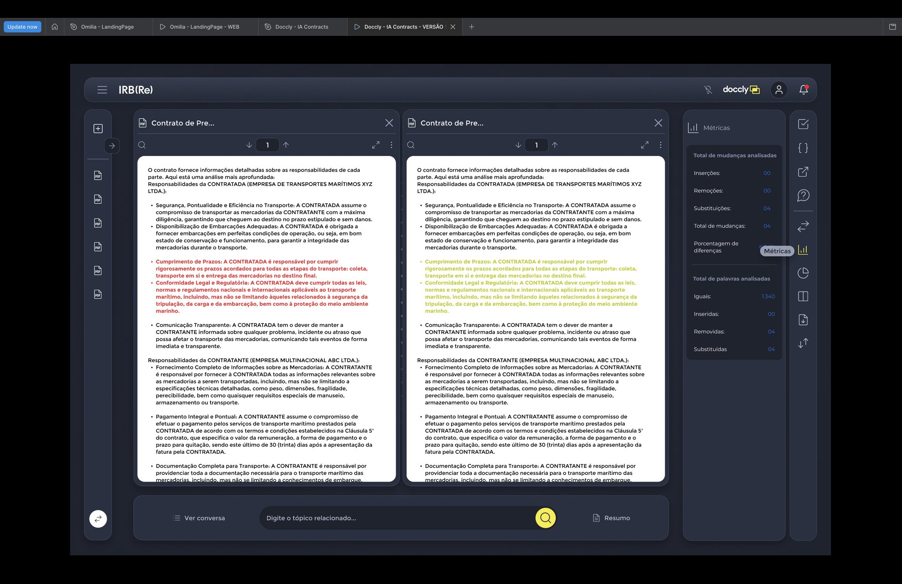
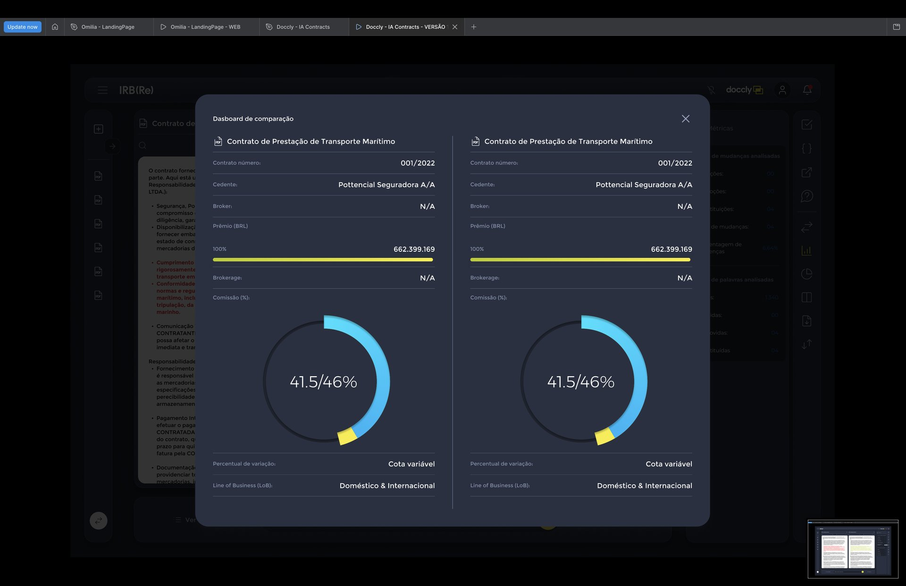
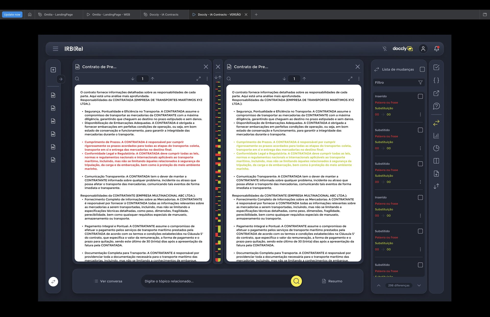
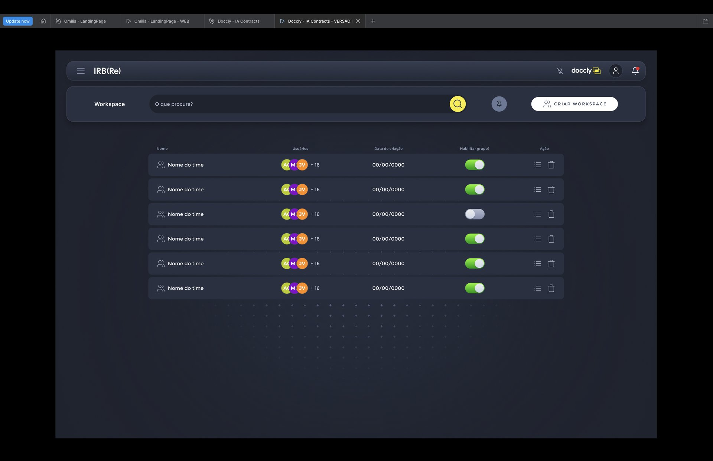

# Telas de referência

Análise das 11 capturas, na ordem do fluxo. Todas as telas internas compartilham o mesmo esqueleto: **cabeçalho** (menu ☰, ícone de microfone desligado, logo, perfil, sino com ponto de notificação) e, abaixo, **barra de ferramentas** ou **área de trabalho** em painéis `surface` com `radius-lg`.

## 1. Login

Fundo `bg-login` com uma esfera orgânica de milhares de pontos azuis luminosos à esquerda (deve ser animada, com alternativa estática). À direita, painel translúcido com borda fina: logo centralizado, campos **User** (e-mail) e **Senha** com ícone de mostrar/ocultar, checkbox "Mater conectado" (erro de digitação na referência: deve ser *Manter*), link "Esqueci a senha" em `accent-blue`, botão **ENTRAR** em `login-primary`, divisor "ou" e três pílulas brancas: Microsoft, Google, Apple.

## 2. Arquivos — visualização em ícone

Barra de ferramentas com abas **Em ícone** (ativa, amarela) / **Em lista**, busca "O que procura?" com botão circular amarelo, botão de fixados (círculo `ink-subtle`) e **UPLOAD ARQUIVO** (desabilitado). Menu lateral com **Fixados** e **Recentes** (nome do anexo + "Grupo de Documento" + menu ⋮). Grade de 6 colunas: card **Criar Pasta de Trabalho** (+ em círculo), cards de pasta listando até 5 PDFs e cards de documento com miniatura da primeira página.

## 3. Pastas de trabalho

Abas **Por pasta** / **Por Arquivo**. Cards de pasta com ícone amarelo de documento Docxy, fixar (📌) e ⋮ no topo, nome centralizado, divisor, rodapé "Tamanho — 4 fontes | 68 MB" e pilha de avatares de iniciais. Fundo vazio com grade de "+" que esmaece nas bordas.

## 4. Detalhe da pasta

Menu lateral vira painel de **Preview**: ícone, nome, tamanho, **Descrição** e **Compartilhado** (pessoas com papel Owner, Editor, Writer, Viewer; "+ Add Pessoa"). Área principal: tabela com Arquivo, Versões (vs01…), Tamanho, Data inserção, Última abertura, Status (chips **Visualizado** `chip-neutral` e **Alterado** `diff-inserted`) e Ação ⋮. UPLOAD ARQUIVO habilitado (pílula branca) e **Voltar**.

## 5. Visualizador de PDF

Três colunas: trilho esquerdo (adicionar documento, expandir, lista de PDFs abertos, botão branco de alternar no rodapé), visualizador central (título truncado, fechar, busca, navegação de página ↓ [1] ↑, tela cheia, ⋮, página em `paper`) e trilho direito de ferramentas: revisão ☑, código { }, extração ↗, assistente (?), comparação ⇄, métricas, dashboard (gráfico de pizza), visualização dividida, download, navegação entre versões ↕.

## 6. Comparação — lista de mudanças

Dois visualizadores lado a lado: original à esquerda com trechos em `diff-removed`, revisado à direita com os mesmos trechos em `diff-inserted`. Barra inferior: **Ver conversa**, campo "Digite o tópico relacionado…" com busca amarela e **Resumo**. Painel **Lista de mudanças**: checkbox geral, **Filtro**, itens com tipo (Substituído/Inserido), "Palavra ou frase" (vermelho), "Substituição" (verde-limão), posição "00 → 00", checkbox de revisado e ⋮; rodapé com contador "298 diferenças" e setas anterior/próxima. Ícone de comparação ativo em amarelo.

## 7. Comparação — extrator

Painel **Extrator** com "Selecione extrator" e cards de campo: rótulo (Prêmio, Broker, Vigência), valor extraído (R$ 5.111.442,22; nome da resseguradora; início/fim) e confiança (✓ 100%). Botão **EXTRAIR** em pílula branca no rodapé.

## 8. Comparação — métricas

Painel **Métricas** em dois blocos: *Total de mudanças analisadas* (Inserções, Remoções, Substituições, Total, Porcentagem de diferenças) e *Total de palavras analisadas* (Iguais, Inseridas, Removidas, Substituídas). Valores alinhados à direita em azul. Tooltip "Métricas" no ícone ao passar o mouse.

## 9. Dashboard de comparação

Modal `surface-overlay` com duas colunas espelhadas (original × revisado): título do contrato, linhas rótulo/valor (Contrato número, Cedente, Broker, Brokerage, Percentual de variação, Line of Business), barra horizontal de Prêmio (gradiente limão→amarelo, 100%) e gráfico circular de Comissão (arco `chart-cyan` com segmento amarelo, rótulo central "41.5/46%"). Título da referência com erro: *Dasboard* → **Dashboard**.

## 10. Comparação — mapa de diferenças

Entre os dois documentos aparece uma coluna estreita de navegação sincronizada (fechar, ↓↑) com marcas vermelhas e verde-limão indicando onde estão as alterações ao longo do documento. A lista de mudanças mistura itens Inserido e Substituído.

## 11. Workspaces

Barra com título **Workspace**, busca, fixados e **CRIAR WORKSPACE**. Tabela em linhas-card `surface`: Nome do time (ícone de grupo), Usuários (avatares + "+16"), Data de criação, **Habilitar grupo?** (toggle verde/cinza) e Ação (lista de membros, lixeira).

## Observações para implementação

- Textos de exemplo ("Documeto-reSeguro", "Nome d Pasta", "Mater conectado", "Dasboard") têm erros de digitação — corrigir na aplicação real.
- A palavra do logo nas telas é "doccly"; usar o arquivo oficial **docxy**.
- Os valores "00", "00/00/0000" e "41.5/46%" são marcadores; a aplicação deve mostrar dados calculados ou "Não identificado".
